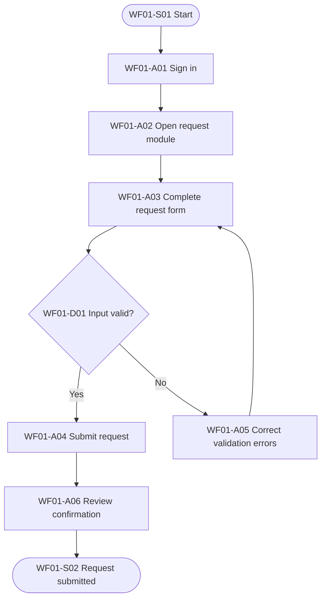

# Workflow Diagram Guidelines

## Mandatory workflow documentation
Create a workflow inventory and at least one end-to-end diagram for every major in-scope module or user process. A list of screenshots or click instructions is not a substitute for a workflow model.

## What diagrams should show
As applicable, include start trigger and end state; actors and responsibility boundaries; user actions and system actions; screens/modules; inputs and outputs; decisions with explicit branch labels; approvals and handoffs; error, retry, cancellation, rejection, and recovery routes; completion criteria and next process.

## Diagram levels
1. Process overview: high-level end-to-end view.
2. Role-specific flow: separate view when permissions, tasks, or screens differ.
3. Sub-process flow: expanded view for complex modules.
4. Exception flow: meaningful failure, rejection, cancellation, or recovery path.
Use only the levels relevant to the actual system. Split complex diagrams rather than making labels unreadable.

## Mermaid conventions
Use Mermaid `flowchart TD` or `flowchart LR` as the preferred editable source. Use rounded nodes for start/end, rectangles for actions, diamonds for decisions, explicit labels on decision exits, and subgraphs for roles/system boundaries where helpful. Assign stable activity IDs such as WF01-A01 and decision IDs such as WF01-D01.

Illustrative example only; replace with verified process:

## Accuracy rules
- Every node and branch must be supported by direct observation or authoritative evidence.
- Do not invent system actions or likely outcomes.
- Mark unknown details as `VERIFY` in working diagrams and log them.
- Diagram sequence must agree with detailed instructions.
- Distinguish user actions from automated system processing.
- Do not equate clicking Submit with successful completion unless the actual completion state is verified.

## Rendering and placement
Keep Mermaid source files in the project (for example, `workflows/WF01-request-submission.mmd`). Render to SVG or high-resolution PNG for insertion into Word/PDF when a local renderer is available. Put the overview before detailed procedures and role/exception diagrams near relevant procedures. Include figure number, workflow ID, title, description, and alt text. If no renderer is available, retain the source and clearly mark the visual diagram as pending; do not claim it is embedded.

## Minimum deliverables per major workflow
- Workflow inventory entry.
- End-to-end diagram.
- Role-specific diagram(s), if role differences exist.
- Exception diagram(s), if meaningful exception paths exist.
- Detailed user procedure(s).
- Traceability to screenshots and outputs.
