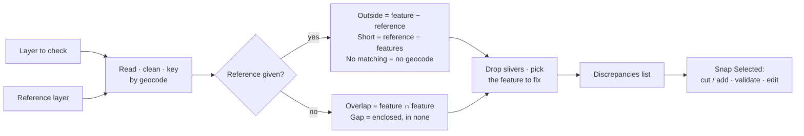

# EA vs Barangay Check

**Script:** [`gmd_processing_tools/ea_versus_bgy.py`](../../gmd_processing_tools/ea_versus_bgy.py)
**Menu:** GMD CO Processing › EA Tools › EA vs Barangay Check

Compares boundaries and lists only the **discrepancies** — each one is just the mismatched area, carrying
the attributes of the feature that must be fixed — then snaps the ones you select.

Requires `geopandas`, `pandas`, `pyogrio` and `shapely` in the QGIS Python.

---

## Check modes

| Mode | With a reference layer | Without one |
|------|------------------------|-------------|
| **EA vs BGY** | Each EA is snapped to its barangay (the barangay is fixed) | — (barangay layer required) |
| **BGY vs BGY** | Each barangay is snapped to the reference barangay with the same `geocode` | Barangays are checked against each other |
| **EA vs EA** | Each EA is snapped to the reference EA with the same `ea_geocode` | EAs are checked against each other |

---

## Run it

1. Load the layers. To check part of a layer, set a filter on it (right-click › Filter).
2. Open **EA vs Barangay Check**, choose the **Check Mode**, the layer to check and (optionally, except
   for EA vs BGY) the reference layer. Set **Ignore slivers below** (default 5 m²).
3. Press **Scan**. Progress, warnings and the summary appear in the Log.
4. The **Discrepancies** list shows every issue, largest first. Click a row to flash it on the map,
   double-click to zoom.
5. Select the rows to fix (**Switch Fix** changes which feature takes them) and press **Snap Selected**.

## How it works

1. **Read.**
   - Both layers are read (honouring any layer filter) with their geometries cleaned.
   - Each feature gets a key: the barangay (first 8 geocode digits) in EA vs BGY and BGY vs BGY, or the
     `ea_geocode` in EA vs EA.
   - Overlays run in the layers' own lat/lon, so shared edges stay exact. Areas are measured in an
     equal-area projection centred on the Philippines.
2. **Compare with a reference.** Features are matched to the reference feature with the same key.
   - **Outside:** feature − its reference. Each piece names the reference area it extends into.
   - **Short of:** reference − the union of its features. The gap is linked to the features within 1 m of
     it. It is given to the one with the longest shared border, but only if that feature has at least 30%
     of the bordering length; otherwise it is marked *Fix manually*.
   - **No matching:** features whose key is not in the reference; the whole feature is listed.
3. **Self check (no reference).**
   - **Overlap:** the shared area of two features, cut from the larger one.
   - **Gap:** land enclosed by the features but in none, added to the feature with the longest border along
     it.
4. **Filter.** Pieces smaller than *Ignore slivers below* are dropped, and the rest are sorted by area.
5. **Snap.** For each selected row the fix feature's new geometry is built:
   - a cut (difference) or an add (union);
   - then holes and specks below the sliver size are removed.

   The result is checked (valid, not empty, expected area, fits the layer, feature unchanged since the
   scan) and written as one undo step. A row that fails the checks is marked *Failed* and the feature is
   left alone.

## Discrepancy types

| Type | Meaning | Snap does |
|------|---------|-----------|
| **Outside …** | Part of a feature outside its reference | Cuts it off the feature |
| **Short of …** | Reference land the feature does not reach (all bordering features listed) | Adds it to the feature with the longest shared border |
| **No matching …** | The feature's geocode is not in the reference layer | Nothing — fix by hand |
| **Overlap** | Self check: land in two features | Cuts it from the larger one (Switch Fix: the other) |
| **Gap** | Self check: land enclosed by the features but in none | Adds it to the feature with the longest border (Switch Fix: the next one) |

Holes and parts smaller than the sliver setting that an edit leaves behind are removed.

---

## Safety checks and saving

Before a feature changes, the new geometry must be valid, not empty, have the expected area, stay valid in
the layer's CRS, fit the layer (a single-part layer cannot take several parts), and the feature must not
have been edited since the scan. Otherwise the row is marked **Failed** with the reason, and the feature is
untouched.

Only geometry changes — attributes such as household counts stay as they are. The checked layer is left in
edit mode:

- **Keep:** Save Layer Edits.
- **Revert:** Toggle Editing › Discard, or **Edit › Undo** (one undo step per Snap Selected).

The reference layer is never edited. No layer is added to the project; each scan removes any
"Discrepancies …" scratch layers left by older versions.

## Fields it looks for

Barangay layers: `geocode`/`bgy_geocode`, `region`, `province`, `city_mun`, `barangay`.
EA layers: `bgy_geocode`/`BGY_GEO`, `ea_geocode`/`geocode`, `name`/`ean`, plus the admin fields.
A barangay is the first 8 digits of the 14-digit geocode.
