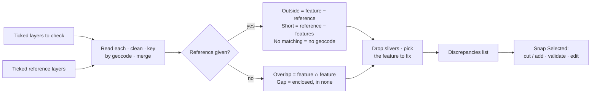

# EA vs Barangay Check

**Script:** [`gmd_processing_tools/ea_versus_bgy.py`](../../gmd_processing_tools/ea_versus_bgy.py)
**Menu:** GMD CO Processing › EA Tools › EA vs Barangay Check

Compares boundaries and lists only the **discrepancies** — each one is just the mismatched area, carrying
the attributes of the feature that must be fixed — then snaps the ones you select.

Requires `geopandas`, `pandas`, `pyogrio` and `shapely` in the QGIS Python.

---

## Check modes

| Mode | With a reference layer | Without one |
|------|------------------------|-------------|
| **EA vs BGY** | Each EA is snapped to its barangay (the barangay is fixed) | — (barangay layer required) |
| **BGY vs BGY** | Each barangay is snapped to the reference barangay with the same `geocode` | Barangays are checked against each other |
| **EA vs EA** | Each EA is snapped to the reference EA with the same `ea_geocode` | EAs are checked against each other |

---

## Run it

1. Load the layers — e.g. every city / municipality of a province. To check part of a layer, set a filter
   on it (right-click › Filter).
2. Open **EA vs Barangay Check** and choose the **Check Mode**.
3. Tick the layers to check and (optionally, except for EA vs BGY) the reference layers. **Select All**
   ticks every layer of the list's kind; **Clear** unticks the list. Slivers below 0.1 m² are automatically
   filtered out.
4. Press **Scan**. Progress, warnings and the summary appear in the Log.
5. The **Discrepancies** list shows every issue, largest first. Click a row to flash it on the map,
   double-click to zoom. The zoom blinks a **dotted outline** on the discrepancy, with a **circle on each vertex of the
   Fix feature that is out of place** (not yet on its neighbour's edge), in orange = cut off, red = added,
   grey = fix by hand, and a **dotted green outline** of the Fix feature as it
   will be after **Snap Selected**. They stay drawn until the next zoom, scan, snap or Clear. A tiny piece
   (e.g. 1 m²) is zoomed to at least ~55 m across so its surroundings show. **Zoom to Selected** does the
   same for several rows. Untick **Blinking dotted outline and snap preview on zoom** (Snap panel) to get
   only the plain red flash.
6. Select the rows to fix (**Switch Fix** changes which feature takes them) and press **Snap Selected**.
   Changed your mind? **Undo Last Snap** takes it back.

### The list and buttons

The **Discrepancies** list has the columns **Issue**, **Status**, **EA Geocode**, **Fix EA**, **EA**,
**Barangay**, **City/Municipality**, **Area (sqm)** and **Note**. In BGY vs BGY mode they read **BGY Geocode**,
**Fix BGY** and **Name**. Use the **Show** list (All issues, one issue, or one status) and the search box to
narrow it; the magnifier button next to them zooms to the selected rows.

| Status | Meaning |
|--------|---------|
| **Not snapped** | Ready to snap. |
| **Snapped** | The feature was changed (unsaved edit). |
| **Failed** | The feature was left untouched; hover the cell for the reason. |
| **Fix manually** | Cannot be snapped automatically. |

| Button | What it does |
|--------|--------------|
| **Select Not Snapped** | Selects every listed row that can still be snapped. |
| **Zoom to Selected** | Zooms to the selected rows (with the blinking outlines if ticked). |
| **Switch Fix** | Gives the selected row to the next feature that could take it. For a detached piece (island), goes through the features of its reference area, nearest first. |
| **Snap Selected** | Changes the features named in **Fix** for the selected rows. |
| **Match Vertices** | Pairs the vertices along every shared edge of the checked layer: a vertex within 1 cm of a neighbour's edge is moved onto it and added to the neighbour, so both hold the same point. In EA vs BGY, a vertex on its barangay line is never moved. Undo Last Snap takes it back. |
| **Undo Last Snap** | Takes back the last snap or Match Vertices (see Safety checks and saving). |
| **Clear** (left column) | Clears the list and the log. |

### Ticking layers

| Row looks | Meaning |
|-----------|---------|
| Normal | A layer of the list's kind (EA or barangay). **Select All** ticks it. |
| Grey, tickable | Looks like another kind, or is an MBI result layer (`case_uuid` / `bgy_part`). Tick it by hand if you need it; **Select All** leaves it out. |
| Grey, not tickable | No geocode field for this mode, or the layer is ticked in the other list (a layer cannot be both checked and reference). |

If exactly one layer fits a list you have not touched, it is ticked for you, so a single EA / barangay pair
is ready to scan straight away.

## How it works

1. **Read.**
   - Every ticked layer is read (honouring any layer filter) with its geometries cleaned. The checked layers
     are then merged into one set, and so are the reference layers; each feature remembers its own layer.
   - Reference features sharing a key — also across layers — are merged into one (with a warning).
   - A ticked layer that is empty or has no usable geocodes stops the scan, and the Log names it, so a
     result never silently misses a city / municipality.
   - Each feature gets a key: the barangay (first 8 geocode digits) in EA vs BGY and BGY vs BGY, or the
     `ea_geocode` in EA vs EA.
   - Checks and overlays run in a projected working CRS in metres, so an edge is straight exactly as the
     map draws it: the layers' own CRS when projected, else the map canvas's CRS, else the WGS 84 / UTM zone
     of the data. It must convert to and from the layers' CRS exactly (a PRS92 ↔ WGS 84 datum shift comes
     back about 1 mm off, so then UTM is used). The Log names the CRS. In lat/lon, a vertex put on a
     kilometre-long edge would show up to ~10 cm off the barangay line on the map. The features' own
     vertices are written back untouched. Areas are measured in an equal-area projection centred on the
     Philippines.
2. **Compare with a reference.** Features are matched to the reference feature with the same key.
   - **Outside:** feature − its reference. Each piece names the reference area it extends into.
   - **Short of:** reference − the union of its features. The gap is linked to the features within 1 m of
     it. It is given to the one with the longest shared border, but only if that feature has at least 30%
     of the bordering length; otherwise it is marked *Fix manually*. A piece no feature touches (a detached
     part such as an island) is marked *Fix manually* too. **Switch Fix** goes through the features of the same
     reference area, nearest first, and **Snap Selected** copies the piece into the chosen one, which becomes
     multipart. If that layer is single-part Polygon, Snap asks to make a multipart copy: it is saved next to
     the original as `<name>_multi.gpkg`, added above it with the same style, and used from then on (also
     ticked in the list). The original is hidden and its file is not changed. Any unsaved edits move to the
     copy, and they are already saved there, so earlier snaps on that layer can no longer be undone.
   - **No matching:** features whose key is not in the reference; the whole feature is listed.
3. **Self check (no reference).**
   - **Overlap:** the shared area of two features, cut from the larger one.
   - **Gap:** land enclosed by the features but in none, added to the feature with the longest border along
     it.
4. **Filter.** Pieces smaller than 0.1 m² (slivers) are dropped, and the rest are sorted by area.
5. **Snap.** For each selected row the fix feature's new geometry is built:
   - a cut (difference) or an add (union);
   - then holes and specks below the sliver size are removed.

   The result is checked (valid, not empty, expected area, fits the layer, feature unchanged since the
   scan) and written to the feature's own layer, as one undo step per layer. A row that fails the checks is marked *Failed* and the feature is
   left alone.

## Discrepancy types

| Type | Meaning | Snap does |
|------|---------|-----------|
| **Outside …** | Part of a feature outside its reference | Cuts it off the feature |
| **Short of …** | Reference land the feature does not reach (all bordering features listed) | Adds it to the feature with the longest shared border. A detached piece (island): choose the feature with Switch Fix, nearest first |
| **No matching …** | The feature's geocode is not in the reference layer | Nothing — fix by hand |
| **Overlap** | Self check: land in two features | Cuts it from the larger one (Switch Fix: the other) |
| **Gap** | Self check: land enclosed by the features but in none | Adds it to the feature with the longest border (Switch Fix: the next one) |
| **Unmatched vertices** | A feature has a vertex within 1 cm of a neighbour's edge with no partner vertex there, or two vertices within 2 mm (duplicate) | Snap Selected matches them (moved at most 1 cm; in EA vs BGY a vertex on its barangay line stays put). Snapped only if a re-check finds nothing left |

Holes and parts smaller than the sliver setting that an edit leaves behind are removed.

---

## Safety checks and saving

Before a feature changes, the new geometry must be valid, not empty, have the expected area, stay valid in
the layer's CRS, fit the layer (a single-part layer cannot take several parts), and the feature must not
have been edited since the scan. It must also really fix what was selected: the cut pieces gone and the
gaps covered, with less than a quarter of the minimum area left over in total, so a row marked **Snapped**
does not come back on the next scan. The scan itself re-checks every piece on the exact geometry, so it
never reports a hairline that is only a rounding effect and could not be snapped away. Otherwise the row is marked **Failed** with the reason, and the
feature is untouched.

When features are checked against each other (no reference), an overlap is cut along the kept feature's own
outline and an added gap is clipped by the features around it, so the fixed edge lands exactly on the
neighbour's edge. Only that edge changes: every other vertex of the feature stays exactly where it was.

When snapping to a reference, the feature is likewise cut to its own reference outline around each piece,
and given all reference land around it that no other feature rightly holds, so the hairline slivers
beside the piece are fixed with it. After every snap, the snapped feature and its neighbours get the same
vertices along their shared edges: a vertex of one within 1 cm of the other's edge is moved onto that edge
(onto the neighbour's vertex if one is that close) and added to the neighbour, and a vertex shared with a
third feature moves there too. Checked against a reference, a vertex on the feature's own reference line is
never moved. Vertices within 2 mm of each other become one point in every feature that has them, and
duplicate vertices and spikes (a vertex that goes out and straight back) are removed, so QGIS finds no
duplicate nodes. Undo Last Snap takes this back with the snap. **Match Vertices** does the same for the whole
layer, which also pairs vertices that were already a hair apart in the data; run it last, from an EA vs BGY
scan, then Scan again to confirm.

**Recommended order:** EA vs EA first, then EA vs BGY, then EA vs EA again to confirm it is clean. A long
hairline strip (thinner than a millimetre) can need a second Scan and Snap in EA vs BGY. If EA vs EA still
finds a gap after that, it is land that lies in no barangay: the barangay layer has a hole or a pinched
inlet there.

Only geometry changes — attributes such as household counts stay as they are. Each snap edits the
feature's own layer, and the changed layers are left in edit mode (the Log names them):

- **Undo Last Snap:** the button next to **Snap Selected** takes back the last snap (features return to
  their old shape, rows to the status they had before, normally *Not snapped*); press again for the snap
  before. It is refused, changing nothing, if those layers were edited or **Edit › Undo** was used
  afterwards. Once their edits are saved or discarded (or a layer is removed) the snaps can no longer be
  undone here.
- **Keep:** Save Layer Edits, or **Layer › Current Edits › Save for All Layers** for several layers.
- **Revert:** Toggle Editing › Discard, or **Edit › Undo** (one undo step per layer per Snap Selected).

The reference layers are never edited. No layer is added to the project; each scan removes any
"Discrepancies …" scratch layers left by older versions.

## Fields it looks for

Barangay layers: `geocode`/`bgy_geocode`, `region`, `province`, `city_mun`, `barangay`.
EA layers: `bgy_geocode`/`BGY_GEO`, `ea_geocode`/`geocode`, `name`/`ean`, plus the admin fields.
A barangay is the first 8 digits of the 14-digit geocode.

---

## Duplicate Geometry Fixer Tab

The dialog includes a dedicated **Duplicate Geometry Fixer** tab to scan and fix polygon layers containing duplicate geometries:

- **Duplicate parts inside a MultiPolygon:** When an individual feature contains repeated, identical polygon rings (commonly flagged as *"duplicate geometry"* in QGIS Geometry Checker). Deduplication preserves the feature attributes while retaining only one instance of each distinct part.
- **Duplicate features across the layer:** When two or more features in the same layer have identical geometries. The tool flags the duplicate feature and allows deleting it.

### How to use:
1. Switch to the **Duplicate Geometry Fixer** tab.
2. Tick the polygon layer(s) to scan in the left panel (use **Select All** or **Clear** as needed).
3. Click **Scan**.
4. The table lists every detected feature with its issue type and details:
   - Double-click any row to automatically zoom and flash that feature on the map canvas.
5. Select rows and click **Fix Selected**, or click **Fix All**.
6. The layers are put into edit mode with changes recorded in the undo stack (**Edit › Undo**). Inspect on the map, then use **Save Layer Edits** to save.

---

## Troubleshooting

| Problem | Fix |
|---------|-----|
| **Scan** is disabled | Tick at least one layer to check (and, for EA vs BGY, at least one barangay layer). The hint under each list says what is missing. |
| A layer is greyed out | It has no geocode field for this mode, or it is ticked in the other list. Hover it for the reason. |
| **Select All** skipped a layer | It does not look like the list's kind (or is an MBI layer). Tick it by hand. |
| "No usable geocodes" / "has no features" | That ticked layer stopped the scan. Untick it or fix its geocodes. |
| Big **Gap** in a self check | Land really outside the ticked layers (e.g. a neighbouring town not loaded). Tick that layer too, or ignore the row. |
