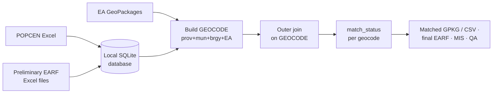

# EARF Post-Processing & Geocode Matching

**Script:** [`gmd_processing_tools/earf_post_processing.py`](../../gmd_processing_tools/earf_post_processing.py)
(window and engine in [`gmd_processing_tools/_coprocessing/`](../../gmd_processing_tools/_coprocessing/))
**Menu:** GMD CO Processing › EA Tools › EARF Post-Processing

Previews three sources, matches them on **geocode** with an outer join, and exports the final deliverables.
If an EA layer is picked in the plugin panel, its GeoPackage path is pre-filled.

---

## Sources

| Source | Format | Geocode |
|--------|--------|---------|
| **2024 POPCEN** estimated households | Excel, imported into a local SQLite database | province + city/mun + barangay + `ean` |
| **Preliminary EARF** | one or more Excel files (or a folder, consolidated into the database) | Prov + Mun + Brgy + EA |
| **EA GeoPackages** | processed EA delineation / merging output (with geometry) | Prov + Mun + Brgy + EA |

The local database keeps 200,000+ records searchable without reopening the Excel files.

---

## Window

| Tab | Use it to |
|-----|-----------|
| **Dashboard** | Source previews (sub-tabs *2024 POPCEN*, *Prelim EARF*, *GeoPackage*): import / load / browse, page through records, remove rows, run the **Consistency Check** (duplicates report) |
| **Geocode Matching** | **Match Sources Now**, filter and page through the results with live KPIs, **Export Output Summary (Excel)…**, **Add Layer to Map**, **Export final data** |
| **EARF Post-Processing** | Post-processing of the matched EARF data |

## How it works

1. **Load.** POPCEN and Preliminary EARF Excel files are imported (or consolidated from a folder) into a
   local SQLite database, so large sources load once and stay fast to search and page. EA GeoPackages are
   read with their geometry.
2. **Key.** Every record gets a `geocode` built the same way in each source: province + city/municipality
   + barangay + EA number, normalised to whole-number text.
3. **Match.** The three sources are **outer-joined** on `geocode`, so every geocode found in any source is
   kept. `match_status` records which sources contributed (table below). The **Consistency Check** reports
   duplicate geocodes within a source.
4. **Output.** The matched table takes its geometry from the EA GeoPackages where available. It is
   exported as a GeoPackage (optionally with a CSV mirror), as the final EARF and MIS workbooks, and as an
   Excel summary. The deliverables are then checked against the PSA output QA rules.

## Match status

Every geocode found in **any** source is kept; `match_status` says which sources have it:

| `match_status` | Present in |
|----------------|------------|
| `MATCHED_ALL` | POPCEN, GeoPackage and EARF |
| `UNMATCHED_POPCEN_GPKG` | POPCEN and GeoPackage only |
| `UNMATCHED_POPCEN_EARF` | POPCEN and EARF only |
| `UNMATCHED_GPKG_EARF` | GeoPackage and EARF only |
| `UNMATCHED_POPCEN` / `UNMATCHED_GPKG` / `UNMATCHED_EARF` | That source only |

---

## Outputs

- Matched GeoPackage layer (geometry from the EA GeoPackages where available), optional CSV mirror.
- Final deliverables: `<pppmm>_ea2026.gpkg`, `<pppmm>_final_earf_<citymun>.xlsx`,
  `<pppmm>_MIS_<citymun>.xlsx`, `<pppmm>_earf2026_PCD.xlsx` — checked against the PSA output QA rules.
- Excel output summary and a duplicates report (CSV).

### Official GeoPackage Attribute Schema (20 Fields)

The exported `<pppmm>_ea2026.gpkg` contains the exact polygon geometries directly from the input GeoPackage (100% geometry pass-through with zero alterations, zero deletions, and native layer CRS preserved) and the following 20 attribute fields (all numeric and code fields are strictly whole numbers with **no decimals**):

| # | Field Name | Data Type | Example | Description |
|---|---|---|---|---|
| 1 | `map_uuid` | String | `b9f3d142-3a52...` | Unique feature UUID (retained from input GPKG or generated) |
| 2 | `ea_geocode` | String | `00604015001000` | Full 14-digit geocode built from `bgy_geocode` + **Final EAN** (no decimals) |
| 3 | `bgy_geocode` | String | `00604015` | 8-digit Barangay PSGC code (no decimals) |
| 4 | `province_code` | String | `006` | 3-digit zero-padded Province code (no decimals) |
| 5 | `city_mun_code` | String | `04` | 2-digit zero-padded City/Municipality code (no decimals) |
| 6 | `barangay_code` | String | `015` | 3-digit zero-padded Barangay code (no decimals) |
| 7 | `ean` | String | `001000` | **Final EAN** (from Sub-tab 3 GeoPackage / Recoded EAN, 6 digits, no decimals) |
| 8 | `region_code` | String | `06` | 2-digit zero-padded Region code (no decimals) |
| 9 | `region` | String | `Western Visayas` | Full name of the Region |
| 10 | `province` | String | `Antique` | Full name of the Province |
| 11 | `city_mun` | String | `Tibiao` | Full name of the City/Municipality |
| 12 | `barangay` | String | `Poblacion` | Full name of the Barangay |
| 13 | `name` | String | `EA 001000` | EA designation label strictly formatted as `EA ` + `ean` matching the Final EAN (no decimals) |
| 14 | `code` | String | `1004` | Cartographic category classification code (no decimals) |
| 15 | `correspondence_geocode` | String | `00604015001000:b9f3d142-3a52...:2026` | Composite correspondence code: `ea_geocode:map_uuid:sy` (no decimals) |
| 16 | `remarks` | String | `Delineated` | Cartographer notes and delineation remarks |
| 17 | `hhcount` | Integer | `145` | Reconciled household count for this EA (integer, no decimals) |
| 18 | `bldgcount` | Integer | `132` | Reconciled building count for this EA (integer, no decimals) |
| 19 | `ea_type` | String | `DELINEATED` | EA Lifecycle type: `RETAINED`, `DELINEATED`, or `MERGED` (any other value defaults to `RETAINED`) |
| 20 | `sy` | String | `2026` | Source Year (strictly `2024` if `ea_type` is `RETAINED`; `2026` if `DELINEATED` or `MERGED`, no decimals) |
