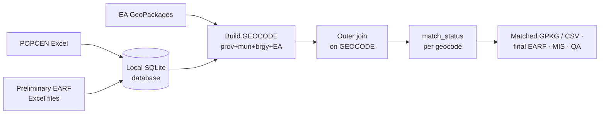

# EARF Post-Processing & Geocode Matching

**Script:** [`gmd_processing_tools/earf_post_processing.py`](../../gmd_processing_tools/earf_post_processing.py)
(window and engine in [`gmd_processing_tools/_coprocessing/`](../../gmd_processing_tools/_coprocessing/))
**Menu:** GMD CO Processing › EA Tools › EARF Post-Processing

Previews three sources, matches them on **geocode** with an outer join, and exports the final deliverables.
If an EA layer is picked in the plugin panel, its GeoPackage path is pre-filled.

---

## Sources

| Source | Format | Geocode |
|--------|--------|---------|
| **2024 POPCEN** estimated households | Excel, imported into a local SQLite database | province + city/mun + barangay + `ean` |
| **Preliminary EARF** | one or more Excel files (or a folder, consolidated into the database) | Prov + Mun + Brgy + EA |
| **EA GeoPackages** | processed EA delineation / merging output (with geometry) | Prov + Mun + Brgy + EA |

The local database keeps 200,000+ records searchable without reopening the Excel files.

---

## Window

| Tab | Use it to |
|-----|-----------|
| **Dashboard** | Source previews (sub-tabs *2024 POPCEN*, *Prelim EARF*, *GeoPackage*): import / load / browse, page through records, remove rows, run the **Consistency Check** (duplicates report) |
| **Geocode Matching** | **Match Sources Now**, filter and page through the results with live KPIs, **Export Output Summary (Excel)…**, **Add Layer to Map**, **Export final data** |
| **EARF Post-Processing** | Post-processing of the matched EARF data |

## How it works

1. **Load.** POPCEN and Preliminary EARF Excel files are imported (or consolidated from a folder) into a
   local SQLite database, so large sources load once and stay fast to search and page. EA GeoPackages are
   read with their geometry.
2. **Key.** Every record gets a `geocode` built the same way in each source: province + city/municipality
   + barangay + EA number, normalised to whole-number text.
3. **Match.** The three sources are **outer-joined** on `geocode`, so every geocode found in any source is
   kept. `match_status` records which sources contributed (table below). The **Consistency Check** reports
   duplicate geocodes within a source.
4. **Output.** The matched table takes its geometry from the EA GeoPackages where available. It is
   exported as a GeoPackage (optionally with a CSV mirror), as the final EARF and MIS workbooks, and as an
   Excel summary. The deliverables are then checked against the PSA output QA rules.

## Match status

Every geocode found in **any** source is kept; `match_status` says which sources have it:

| `match_status` | Present in |
|----------------|------------|
| `MATCHED_ALL` | POPCEN, GeoPackage and EARF |
| `UNMATCHED_POPCEN_GPKG` | POPCEN and GeoPackage only |
| `UNMATCHED_POPCEN_EARF` | POPCEN and EARF only |
| `UNMATCHED_GPKG_EARF` | GeoPackage and EARF only |
| `UNMATCHED_POPCEN` / `UNMATCHED_GPKG` / `UNMATCHED_EARF` | That source only |

---

## Outputs

- Matched GeoPackage layer (geometry from the EA GeoPackages where available), optional CSV mirror.
- Final deliverables: `<pppmm>_ea2026.gpkg`, `<pppmm>_final_earf_<citymun>.xlsx`,
  `<pppmm>_MIS_<citymun>.xlsx` — checked against the PSA output QA rules.
- Excel output summary and a duplicates report (CSV).
