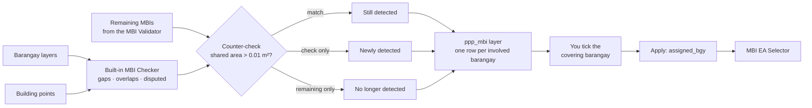

# MBI Barangay Selector

**Script:** [`gmd_processing_tools/mbi_bgy_selector.py`](../../gmd_processing_tools/mbi_bgy_selector.py)
**Menu:** GMD CO Processing › EA Tools › MBI Barangay Selector

Counter-checks the **remaining MBIs** (the gaps, overlaps and disputed areas the PSOs declared pending)
against a fresh MBI check of the barangay layers, then lets you choose the **barangay that covers** each
MBI. Next, the [MBI EA Selector](mbi_ea_selector.md) chooses the EA inside that barangay.

The MBI check is a built-in copy of GEMMA's MBI Checker v13, so **GEMMA does not need to be installed**.

---

## Quick start

1. **Remaining MBI layer** — pick it, or click **Browse GPKG…** to load `remaining_cases` (or
   `pending_cases` / `ref_mbi_cases`) from a `ref_mbi_reviewed-*.gpkg` of the MBI Validator.
2. **Barangay Layers** — tick every layer the involved barangays come from.
3. **Building Points** — pick the layer and its geocode field (barangay geocode, or an EA geocode that
   starts with it). Used for building counts and Auto-Assign.
4. Click **Run Check & Counter-Check** (orange box). It adds a `ppp_mbi` layer and lists its cases.
   Already have a `ppp_mbi` layer? Pick it and click **Load MBI Cases** instead.
5. In the list, **tick the covering barangay** of each MBI (or **Auto-Assign Pending**, then review).
6. Click **Apply Coverage** — writes `assigned_bgy` into the `ppp_mbi` layer.
7. Click **Choose EAs in MBI EA Selector…** to continue in the [MBI EA Selector](mbi_ea_selector.md).

Optional: **Join MBI to Barangays** and **Export GPKG + CSV**.

> **Nothing is saved until you say so.** Apply edits the layer in a normal QGIS edit session —
> **Save Edits** to keep, **Edit › Undo** / **Discard Edits** to revert. The remaining MBI layer and the
> barangay layers are never edited.

---

## How it works

1. **Detect.** The barangay layers are merged, reprojected to EPSG:3857 and repaired. The built-in MBI
   Checker then finds:
   - **overlaps** — land inside two barangays;
   - **gaps** — holes enclosed by the barangays but inside none;
   - **disputed areas** — polygons whose `boundary` is *Contested*, plus the barangays within 0.50 m of them.

   Findings under 0.10 m² are dropped as slivers. Barangays within 0.50 m of a gap or disputed area count
   as involved. Each contiguous piece becomes one case (`case_uuid`), and the building points inside it are
   counted.
2. **Counter-check.** Every detection is intersected with the remaining MBIs. Sharing more than 0.01 m²
   makes a match. A remaining Gap or Overlap must match the same type; a Disputed (or untyped) remaining MBI
   matches any type. The matched remaining case IDs and their type, status and remarks are copied into
   `ref_case_uuid`, `ref_mbi_type`, `ref_status` and `ref_remarks`.
3. **Classify.**
   - A detection with a match is **Still detected**.
   - A detection without one is **Newly detected**.
   - A remaining MBI that no detection matched is added back as **No longer detected**, with nothing to cover.
4. **Split per barangay.** Each case is written as one row per involved barangay: the same geometry, with
   that barangay's `geocode` and names. This becomes the `ppp_mbi` layer.
5. **Decide.** For each case, the MBI is clipped to every involved barangay (MBI ∩ barangay) to get the part
   each barangay could keep.
   - **Gap, or MBI between two barangays:** the ticked barangay takes the whole MBI and the others release it.
   - **Overlap across three or more barangays:** each ticked barangay keeps its own part, minus what a
     barangay ticked before it keeps. Whatever is left uncovered makes the case *Partly covered*.
   - Building points inside the kept parts are credited to the barangay that keeps them.
6. **Write.** Apply writes the covering barangay geocode(s) to `assigned_bgy` on every row of the case.
   **Join MBI to Barangays** cuts the kept parts out of the barangay features and adds each kept part as its
   own feature with the covering barangay's attributes.

---

## The counter-check

Every MBI found by the check is compared with the remaining MBIs (a match = they share more than 0.01 m²;
touching along an edge is not a match).

| Detection | Meaning | In the list |
|-----------|---------|-------------|
| **Still detected** | The check still finds the remaining MBI | normal row |
| **Newly detected** | Found by the check, but not in the remaining layer | **light green** row |
| **No longer detected** | A remaining MBI the check no longer finds | grey, cannot be ticked |

- Disputed remaining MBIs are **not skipped**. A remaining Disputed (or untyped) MBI matches any detection
  sharing area; a Gap or Overlap matches the same type only.
- **Run modes:** Gaps, Overlaps and Disputed · Overlaps Only · Gaps Only · Disputed Only.
- **Skip within-barangay cases** leaves out MBIs that involve a single barangay.

---

## Choosing the covering barangay

Each MBI is **one row per involved barangay** in the `ppp_mbi` layer (same `case_uuid` and geometry).

| Case | How ticking works |
|------|-------------------|
| **Gap** | One barangay absorbs the whole gap. Ticking another moves it. |
| **MBI between two barangays** | One barangay takes the whole MBI. **Ticking one unticks the other.** |
| **Overlap across three or more barangays** | Can be **shared out**: tick several, and each keeps only its own part (the MBI clipped to that barangay). Where two ticked barangays contain the same piece, the one **ticked first** keeps it. The case is *Partly covered* until the ticked parts fill the MBI. |

**Auto-Assign Pending:** single-barangay cases go to that barangay; others go to the barangay that owns
most of the buildings inside the MBI (needs Building Points). Shared overlaps go to every barangay with
tagged buildings, most first. No tagged buildings or a tie stays Pending.

**What the Role / Status column says** — it spells out what each tick does:

| Row | Text |
|-----|------|
| Not decided yet | **☐ Tick if this barangay covers it** · case row **Pending — tick the covering barangay below** (peach) |
| Ticked barangay | **✔ Covers — keeps the overlap** / **✔ Covers — its boundary is extended over the gap** / **✔ Covers its part (x% of the MBI)** (green) |
| Other barangays | **✖ Gives up the overlap — cut out of it** / **Not extended — stays as it is** (grey) |
| Case row when done | **✔ Done — covered by …** (green), or **Partly covered (x%) — tick another barangay** (cream) |

The **MBI Level** column uses its own cool colours (lavender = Inter-Region → periwinkle → sky blue →
pale aqua → slate = Within-Barangay), so it never looks like a status. Both colour keys are in the legend
under the list.

Click a row to select it on the map, double-click to zoom, right-click for more options.

---

## What gets written

| Output | Contents |
|--------|----------|
| `assigned_bgy` (Apply) | Geocode(s) of the covering barangay on every row of the case — comma-separated, in tick order, for a shared overlap. Empty while Pending. |
| **No coverage status** | This tool writes **no** `coverage_status`. The status is decided per EA and written by the [MBI EA Selector](mbi_ea_selector.md). |
| `ppp_mbi` layer (Run Check) | Temporary layer; `ppp` = province code (first 3 digits of the barangay geocodes; several joined with `_`). Checker fields plus `detection`, `ref_case_uuid`, `ref_mbi_type`, `ref_status`, `ref_remarks`. Right-click › **Make Permanent** to keep it. |
| **Barangays + MBI** (Join MBI to Barangays) | Copy of the ticked barangay layers with every kept MBI part added as its own feature carrying the covering barangay's attributes; `bgy_part` = `MBI` / `is_mbi` = 1, drawn hatched magenta. Kept parts are cut out of the other barangays — **dissolve by geocode** to get the corrected barangays. |
| `ppp_mbi_<date>_<time>.gpkg` (Export) | The `ppp_mbi` layer (with unsaved edits) and `mbi_bgy_joined`. |
| `ppp_mbi_<date>_<time>.csv` (Export) | One row per case / barangay: detection, type, level, areas, building counts, `chosen`, `assigned_bgy`. |

> Keep the coverage field named **`assigned_bgy`** — the MBI EA Selector reads that name.

---

## Troubleshooting

| Problem | Fix |
|---------|-----|
| Barangay in red / "not found" | Its layer is not ticked, or its geocode differs from the MBI layer's `geocode`. Tick the layer and Load again. |
| Can only tick one barangay | Gaps and MBIs between two barangays always take one. An overlap across three or more can be shared only when the layers of **all** its barangays are ticked. |
| Stays *Partly covered* | Select the case row to see the uncovered part, then tick the barangay that contains it. |
| "Choose EAs…" warns about the field | Set the Coverage field back to `assigned_bgy` and Apply. |
| Made a mistake | Before Apply: **Reset Choices** or untick. After Apply: **Edit › Undo** or **Discard Edits**. |
