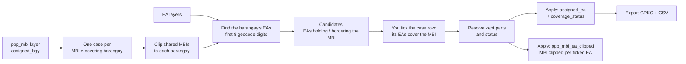

# MBI EA Selector

**Script:** [`gmd_processing_tools/mbi_ea_selector.py`](../../gmd_processing_tools/mbi_ea_selector.py)
**Menu:** GMD CO Processing › EA Tools › MBI EA Selector

Chooses the **EA that covers** each MBI, inside the barangay chosen in the
[MBI Barangay Selector](mbi_bgy_selector.md), and writes the final **coverage status**. This is the only
tool that writes `coverage_status`.

No MBI check runs here — the MBI layer comes from the MBI Barangay Selector, so you only load its cases.

---

## Quick start

1. **MBI Results Layer** — pick the `ppp_mbi` layer of the MBI Barangay Selector (or click
   **Choose EAs in MBI EA Selector…** there, which opens this window with the layer already picked).
   **Choose EAs inside the covering barangay** is ticked automatically.
2. **EA Layers** — tick the EA layers of the covering barangays.
3. **Building Points** (optional) — pick the layer and its geocode field to count buildings per EA.
4. Click **Load MBI Cases** (green).
5. **Tick the case row** — the tickbox sits on the case, not on the EAs: you assigned a barangay, so
   its EA(s) listed under the case cover the MBI. (Or **Auto-Assign Pending**, then review.)
   To pick one EA yourself, **right-click its row**.
6. Click **Apply Coverage** — writes `assigned_ea` and `coverage_status` into the MBI layer, and adds
   the `ppp_mbi_ea_clipped` layer (each MBI clipped to the boundary of every ticked EA).
7. Click **Export GPKG + CSV** to save the result and a decision log.

> **Nothing is saved until you say so.** Apply edits the layer in a normal QGIS edit session —
> **Save Edits** to keep, **Edit › Undo** / **Discard Edits** to revert. EA layers are never edited.
> `ppp_mbi_ea_clipped` is a temporary layer — right-click › **Make Permanent** to keep it.

---

## How it works

1. **Read the barangay decisions.** The `ppp_mbi` rows are grouped by `case_uuid`.
   - MBIs with an empty `assigned_bgy` are skipped, and so are *No longer detected* MBIs.
   - Every other MBI becomes one case per covering barangay, in the order the barangays were ticked.
2. **Clip shared MBIs.** When an MBI has several covering barangays, each barangay's part is the MBI ∩ the
   union of that barangay's EAs, minus what an earlier barangay keeps. This matches how the Barangay
   Selector shared it out.
3. **Find the barangay's EAs.** The ticked EA layers are read once. An EA belongs to a barangay when the
   first 8 digits of its geocode match: the EA layer's `geocode` / `bgy_geocode` / `bgy_geo` field first,
   else its `ea_geocode`.
4. **Pick the candidates.**
   - **Overlap / disputed:** the barangay's EAs whose intersection with the MBI is larger than 0.5 m².
   - **Gap**, or when no EA holds any of it: the EAs touching the MBI or within the search distance. The
     distance is measured in EPSG:3857 and corrected for latitude.
   - **Nothing that close:** the 3 nearest EAs.
5. **Resolve.**
   - **One EA covers the MBI:** the EA holding most of the MBI (for a gap, the one with most tagged
     buildings, else the nearest) keeps the whole case geometry.
   - **Several EAs share an overlap:** ticking the case gives it to every EA under it — each keeps the
     MBI ∩ EA, minus what an EA before it keeps (largest part first).
   - **Status:** the case is *Covered* when the leftover is at most 0.5 m² (or 0.1% of the MBI), otherwise
     *Partly covered*.
   - **Buildings:** each building point goes to the first covering EA whose kept part contains it.
6. **Write.** Apply edits only the covering barangay's rows: `assigned_ea` (comma-separated) and
   `coverage_status`. Rows of barangays not chosen get `2_Not Covered`. All of this is one undoable edit
   command. Apply also adds `ppp_mbi_ea_clipped`: the kept part of every ticked EA as its own feature.
   Export writes the MBI layer, the kept / unassigned parts and the CSV log.

---

## How the cases are built

- Each MBI is listed **once per covering barangay** (from `assigned_bgy`). An overlap shared out between
  barangays is listed once for each, holding only **that barangay's part** (shown as *its part (60%)* in the
  Barangay column; select the case row to see it on the map).
- MBIs with **no covering barangay yet** and **No longer detected** MBIs are skipped — the log says how
  many. Assign them in the Barangay Selector first.
- **Only the EAs of the covering barangay** are offered. A barangay and its EAs are matched on the
  **first 8 digits** of the geocode: barangay `02709007000000` gets EAs `02709007001000`, `02709007002000`, …

| MBI type | EAs offered |
|----------|-------------|
| **Overlap / disputed area** | The barangay's EAs holding part of it. All of them cover the case — each keeps only its own part. |
| **Gap** | The barangay's EAs bordering the gap or within **EAs within … m of a gap** (default 5 m). One EA absorbs the whole gap. |
| **None that close** | The 3 nearest EAs of the barangay, with their distance (*12.0 m away*) — check them on the map. |

**Barangay name fallback:** a row without a barangay name gets it by its geocode (`geocode` /
`bgy_geocode` / `bgy_geo`) — first from the other rows of the MBI layer, then from the ticked EA layers'
`barangay` / `bgy_name` field.

---

## Ticking a case

The tickbox is on the **case row**, not on the EA rows: a barangay was assigned to the MBI in the MBI
Barangay Selector, so that barangay's EA(s) — listed under the case — are what covers it. The EA rows are
information only; **right-click** one to set it as the only covering EA, or to add / remove one EA of a
shared overlap.

| Case | Covering EA | Others |
|------|-------------|--------|
| Overlap | **✔ Covers — keeps the overlap** | ✖ Gives up the overlap — cut out of it |
| Shared overlap | **✔ Covers its part (x% of the MBI)** — the largest part wins a shared piece | ✖ Gives up, or *Gives up x% of its part* |
| Gap | **✔ Covers — its boundary is extended over the gap** | Not extended — stays as it is |

Before you tick the case, each EA row reads **☐ Tick the case row above to cover it**. Case status:
**☐ Tick to cover it with the EAs below** (peach) → **✔ Done — covered by …** (green), or
**Partly covered (x%)** (cream) when the covering EAs do not fill the MBI yet. The **MBI Level** column has its own cool colours (lavender → blue → aqua
→ slate), shown in the legend under the list.

**Auto-Assign Pending:** single-EA cases go to that EA; others to the EA owning most of the buildings
inside the MBI (needs Building Points); shared overlaps to every EA with tagged buildings, most first.

---

## What gets written

Written on the **covering barangay's row(s)** of the MBI layer:

| Field | Contents |
|-------|----------|
| `assigned_ea` | Covering EA geocode(s), comma-separated, largest part first |
| `coverage_status` | `1_Covered` · `2_Not Covered` (still pending) · `3_Partially Covered` (part of a shared overlap has no EA yet) |

- Rows of barangays **not chosen** get no EA and `2_Not Covered`.
- `assigned_bgy` is never changed (the field box turns red if you type that name).
- Field names can be changed in the panel (letters, digits and underscores; all different).

**`ppp_mbi_ea_clipped`** (temporary layer added by Apply; `ppp` = province code of the covering barangays,
e.g. `027_mbi_ea_clipped`) has **the same fields as the `ppp_mbi` layer**. Instead of one row listing every
EA in `assigned_ea`, the covering barangay's row is split into **one row per ticked EA**, clipped to that EA:

| Row in `ppp_mbi` | Rows in `ppp_mbi_ea_clipped` |
|------------------|------------------------------|
| Covering barangay, two EAs ticked (`assigned_ea` = `…001000,…002000`, `1_Covered`) | Two rows: MBI ∩ EA 001000 (`assigned_ea` = `…001000`, `1_Covered`) and MBI ∩ EA 002000 (`…002000`, `1_Covered`) |
| Covering barangay, one of two EAs ticked (`3_Partially Covered`) | MBI ∩ that EA (`1_Covered`), plus the part no EA keeps (`assigned_ea` empty, `2_Not Covered`) |
| Gap, or an MBI with a single EA | One row, the whole MBI, `1_Covered` |
| Barangay not chosen, or pending case (`2_Not Covered`) | Copied as is, `2_Not Covered` |

Each Apply replaces the layer. It is drawn by `coverage_status` — green `1_Covered`, grey dashed
`2_Not Covered` — so the legend has two entries however many EAs are ticked; the outlines show each EA's part.

**Export GPKG + CSV** (into the Export folder; asks to Apply first if needed):

| File | Contents |
|------|----------|
| `mbi_ea_coverage_<date>_<time>.gpkg` | `mbi_ea_coverage` — the whole MBI layer with the coverage fields (unsaved edits included); `mbi_ea_coverage_parts` — the part of each MBI every covering EA keeps (`Kept`), plus `Unassigned` leftovers |
| `mbi_ea_coverage_<date>_<time>.csv` | One row per case / EA: covering barangay, EA code / name, distance, areas, buildings, role, `assigned_ea`, `coverage_status` |

---

## Other MBI layers

Unticking **Choose EAs inside the covering barangay** (or loading an EA MBI Checker result, which has no
`assigned_bgy`) uses the original EA mode: every involved EA of the case is offered and Apply also writes
`ea_role` (Covers / Releases). The **Run Check** box is hidden in this version.

---

## Troubleshooting

| Problem | Fix |
|---------|-----|
| *No EA found in the selected EA layers* | Tick the EA layer of that barangay, then Load again. Check its geocodes share the barangay's first 8 digits. |
| Fewer cases than MBIs | MBIs still pending in the Barangay Selector are skipped. A shared overlap gives one case per barangay, so there can also be more. |
| Barangay column shows only a geocode | No name found for it in the MBI layer or the EA layers — tick an EA layer with a `barangay` / `bgy_name` field. |
| Only one EA covers an overlap | The log after **Load MBI Cases** lists each such case under *overlap case(s) where only ONE EA can cover the MBI*, with the reason — usually no EA of the barangay holds more than 0.5 m² of the MBI (the EAs only touch it or lie within the search distance). Check that the EA layer lines up with the MBI on the map. Gaps always take one EA. |
| Stays *Partly covered* | Select the case row to see the orange leftover, then right-click the EA that contains it and add it as a covering EA. |
| Load MBI Cases greyed out | Pick a layer with `case_uuid` and tick at least one EA layer. |
| Made a mistake | Before Apply: **Reset Choices** or untick the case. After Apply: **Edit › Undo** or **Discard Edits**. |
