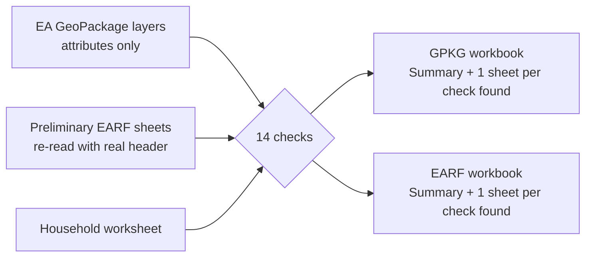

# [TEST] EARF Inconsistency Checks

Script: [`gmd_processing_tools/test_earf_inconsistency.py`](../../gmd_processing_tools/test_earf_inconsistency.py) ·
Menu: **GMD CO Processing › [TEST] EARF Inconsistency Checks**

> **Test tool.** It is a faster rebuild of the EARF validation, written separately from EARF Post-Processing.

This tool checks the 2026 EA GeoPackage and the Preliminary EARF. Both are cross-checked against the 2024 POPCEN
Estimated Number of Households worksheet. It writes two workbooks in the *EA List of Inconsistencies* template:

- `<code>_EA List of Incons (GPKG).xlsx`
- `<code>_EA List of Incons (EARF).xlsx`

## Quick start

1. Add the EA GeoPackage layer to the QGIS project and choose it in **1. EA GeoPackage (ea2026)**.
2. **2. Preliminary EARF** and **3. Est. No. of Households** are files, not layers. The tool searches the
   GeoPackage's folder and fills in the spreadsheet whose name matches (`earf`; `household`, `hh`,
   `popcen` or `estimated`). Otherwise press **Browse…** (it opens in that folder) or type the path,
   then pick the **Sheet** (for example `EA2026`). All three inputs are required.
3. Press **Run Check**. The upper table lists each check with its **Frequency**.
4. Click a check to see its records. Double-click a GeoPackage record to zoom to that EA.
5. Set **4. Output folder**, then press **Export Excel**.

## How it works

1. **GeoPackage**: features are read without geometry, which is fast. Unsaved edits are included. `geocode` is
   the final code, made of the barangay code plus `new_ean`. The 2024 code is the barangay code plus `ean`.
2. **EARF**: the spreadsheet file is read directly. The tool finds the *Prov / Mun / Brgy / EA* header and skips
   the `(2) (3) …` row. Only rows whose name starts with *EA* are checked. Province, city and barangay names
   come from the title rows. The 2024 code is Prov+Mun+Brgy+EA. The final code uses the New EA Code in
   place of EA when that code is filled.
3. **Household worksheet**: the header row with `province_code … barangay_code` is found. Rows above EA level
   are dropped, and the *EA Subject for Delineation / Merging* flags are kept.
4. All checks run as whole-column pandas operations.

| validation_id | Rule |
|---|---|
| `dup_ea` | Two or more records whose attributes are all identical. Only `fid` and the Excel row number are ignored |
| `dup_new_ean` | The same New EA Code value on two or more records in one barangay. Merged EAs are excepted |
| `missing_geo` | GPKG workbook only: household geocodes that are not in the GeoPackage (as `geocode` or barangay + `ean`; only the GeoPackage's city/muns). EAs the GeoPackage marks **Merged** are not missing |
| `earf_missing_geo` | EARF workbook only: household geocodes that are not in the EARF (only the EARF's city/muns are checked). EAs the GeoPackage marks **Merged** are not missing |
| `inv_ea_type` | EA Type is something other than Retained, Delineated or Merged |
| `inv_hhcount` | Household count equals building count. In the EARF workbook the Geocode is the Prelim EARF geocode (Prov+Mun+Brgy+New EA Code, or EA when blank) |
| `inv_new_ean` | New EA Code is not 6 digits |
| `inv_sy` | Source year is wrong for the EA Type: Retained must be 2024, Delineated or Merged must be 2026 |
| `null_ea_count` | EA count is blank. In the EARF, only the first row of each 2024 EA is checked |
| `null_ea_type`, `null_hhcount`, `null_sy` | The value is blank |
| `null_new_ean` | A Delineated or Merged EA has no New EA Code |
| `null_remarks` | Reads the 3 files together: the household worksheet marks the EA for delineation or merging, but it is Retained with no remarks in the GeoPackage **or** the EARF. Listed in both workbooks; the remarks column names the file(s) |

Checks that find no inconsistency are left out of the results table and of the exported workbooks. A check
that could not run (for example, no household worksheet) is still listed on the Summary as *Not checked*.

## Troubleshooting

- *no 'Prov / Mun / Brgy / EA' header row found*: the wrong sheet is loaded.
- *the layer has no 'geocode' field*: the chosen layer is not an ea2026 layer.
- *Cannot write the file*: the workbook is open in Excel. Close it and export again.
