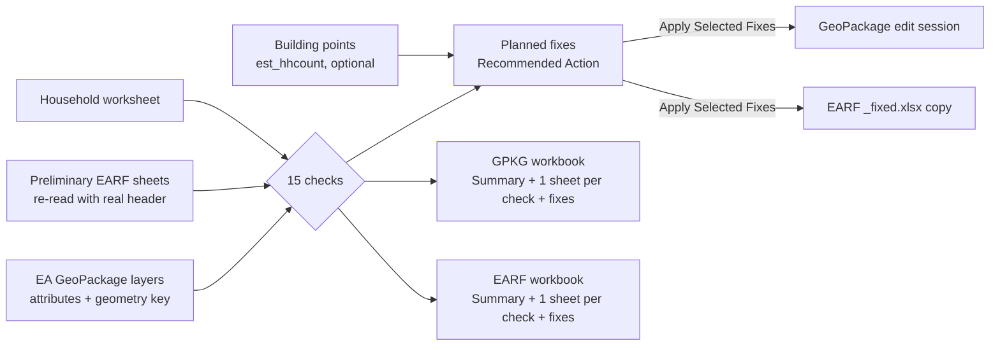

# [TEST] EARF Inconsistency Checks

Script: [`gmd_processing_tools/test_earf_inconsistency.py`](../../gmd_processing_tools/test_earf_inconsistency.py) ·
Menu: **GMD CO Processing › [TEST] EA Post-Processing › [TEST] EARF Inconsistency Checks**

> **Test tool.** It is a faster rebuild of the EARF validation, written separately from EARF Post-Processing.

This tool checks the 2026 EA GeoPackage and the Preliminary EARF. Both are cross-checked against the 2024 POPCEN
Estimated Number of Households worksheet. Where the template's **Recommended Action** can be automated, the tool
also fixes the records. It writes two workbooks in the *EA List of Inconsistencies* template:

- `<code>_EA List of Incons (GPKG).xlsx`
- `<code>_EA List of Incons (EARF).xlsx`

## Quick start

1. Add the EA GeoPackage layer to the QGIS project and choose it in **1. EA GeoPackage (ea2026)**.
2. **2. Preliminary EARF** and **3. Est. No. of Households** are files, not layers. The tool searches the
   GeoPackage's folder and fills in the spreadsheet whose name matches (`earf`; `household`, `hh`,
   `popcen` or `estimated`). Otherwise press **Browse…** (it opens in that folder) or type the path,
   then pick the **Sheet** (for example `EA2026`). These three inputs are required.
3. Optional: choose **4. Building points (household recount)**, a point layer with `est_hhcount`
   (for example `bldg_point`). With *(none)*, the household checks are flagged only.
4. Press **Run Check**. The upper table lists each check with its **Frequency**, **Auto-fix** count and
   **Recommended Action**.
5. Click a check to see its records. Double-click a GeoPackage record to zoom to that EA.
6. Nothing is fixed until you choose. Tick the **Auto-fix** box of each validation_id you want fixed; GPKG
   and EARF rows are ticked separately. The **Planned Fixes** tab lists the changes of the ticked checks only,
   with the old and new value.
7. Set **5. Output folder**, then press **Export Excel**. This is required before fixing, so the workbooks keep
   a record of the records as they were and of the planned fixes. If you press **Apply Selected Fixes** without
   exporting, a popup asks you to export first (**Export Excel Now**).
8. Press **Apply Selected Fixes**:
   - GeoPackage: the fixes go into the layer's edit session. Review them, then **Save** (or **Roll Back**)
     the layer edits in QGIS.
   - EARF: the fixes are saved to `<EARF name>_fixed.xlsx` in the output folder. The original is not changed.

   The tool then checks again, using the fixed EARF, so only what is left is listed. Export again to record what
   is left and the fixes made. The export is asked for once per **Run Check**: after it, you can fix one
   validation_id after another without exporting again.

## How it works

1. **GeoPackage**: features are read with their attributes and a key of the normalized geometry (for
   `dup_geom`). Unsaved edits are included. `geocode` is
   the final code, made of the barangay code plus `new_ean`. The 2024 code is the barangay code plus `ean`.
2. **EARF**: the spreadsheet file is read directly. The tool finds the *Prov / Mun / Brgy / EA* header and skips
   the `(2) (3) …` row. Only rows whose name starts with *EA* are checked. Province, city and barangay names
   come from the title rows. The 2024 code is Prov+Mun+Brgy+EA. The final code uses the New EA Code in
   place of EA when that code is filled.
3. **Household worksheet**: the header row with `province_code … barangay_code` is found. Rows above EA level
   are dropped, and the *EA Subject for Delineation / Merging* flags are kept.
4. All checks run as whole-column pandas operations.
5. **Fixes** are planned on a copy of the data (nothing is changed until **Apply Selected Fixes**), in the order below.

| validation_id | Rule | Automatic fix |
|---|---|---|
| `dup_ea` | Two or more records whose attributes are all identical. Only `fid` and the Excel row number are ignored | The first record is kept; the copies are deleted |
| `dup_geom` | GPKG workbook only: two or more EAs with the same geometry, even if their attributes differ. Vertex order and start point are ignored | The first EA is kept; the others are deleted (check their attributes before saving) |
| `dup_new_ean` | The same New EA Code value on two or more records in one barangay. Merged EAs are excepted | The first record keeps the code; the others are renumbered (EADM rule) |
| `missing_geo` | GPKG workbook only: household geocodes that are not in the GeoPackage (as `geocode` or barangay + `ean`; only the GeoPackage's city/muns). EAs the GeoPackage marks **Merged** are not missing. The remarks name the geocode and whether it is also missing in the other file, e.g. *02011009000000 missing in the GeoPackage (found in the EARF)* | Flag only (list) |
| `earf_missing_geo` | EARF workbook only: household geocodes that are not in the EARF (only the EARF's city/muns are checked). EAs the GeoPackage marks **Merged** are not missing. The remarks name the geocode and whether it is also missing in the other file, e.g. *02011009000000 missing in the GeoPackage (found in the EARF)* | Flag only (list) |
| `inv_ea_type` | EA Type is something other than Retained, Delineated or Merged | Set to **Retained** |
| `inv_hhcount` | Household count equals building count. In the EARF workbook the Geocode is the Prelim EARF geocode (Prov+Mun+Brgy+New EA Code, or EA when blank) | `hh_count` = sum of `est_hhcount` of the building points in the EA |
| `inv_new_ean` | New EA Code is not 6 digits | Flag only |
| `inv_sy` | Retained must be 2024; Delineated and Merged must be 2026 | Source Year set from the EA Type |
| `null_ea_count` | EA count is blank. In the EARF, only the first row of each 2024 EA is checked | Flag only |
| `null_ea_type` | EA Type is blank | Flag only |
| `null_hhcount` | Household count is blank | Same as `inv_hhcount` |
| `null_new_ean` | A Delineated or Merged EA has no New EA Code | Delineated: renumbered (EADM rule). Merged: flag only |
| `null_remarks` | Reads the 3 files together: the household worksheet marks the EA for delineation or merging, but it is Retained with **no** remarks in the GeoPackage, **or** Retained **with** remarks in the EARF (an EARF row with no remarks is not flagged). Listed in both workbooks; the remarks column names the file(s) and the reason | Flag only |
| `null_sy` | Source Year is blank | Source Year set from the EA Type |

Only the ticked validation_ids are fixed. They run in this order: `dup_ea` → `dup_geom` → `inv_ea_type` → `inv_sy` /
`null_sy` → `inv_hhcount` / `null_hhcount` → `null_new_ean` → `dup_new_ean`. Each fix works on the result of
the ticked fixes before it. For example, an invalid EA Type fixed to Retained then gets Source Year 2024, but
only when `inv_ea_type` is ticked too. The **Auto-fix** count assumes the checks above it are also fixed; the
**Planned Fixes** tab shows what will really change.

### Rules used by the fixes

- **EA Type** is written the way the file writes its types (`RETAINED` or `Retained`).
- **Source Year**: Retained = 2024, Delineated / Merged = 2026. A blank EA Type is left flagged.
- **Household recount**: the sum is rounded up to a whole number (168.963 → 169). Each building point is counted once, in the first EA polygon it falls in, even if it
  sits on a shared boundary. An EARF row takes the sum of the GeoPackage EA with the same final geocode. An EA
  with no building point is left flagged.
- **EADM renumbering**: an EA keeps its own (mother) code when that code is free in the barangay. Otherwise it
  gets the next EA number after the highest one in the barangay, followed by the mother's 3 digits. For
  example, mother `005000` with last EA `009000` gives `010005`. A barangay's single EA `000000` splits into
  `001000`, `002000`, and so on. In the GeoPackage, `geocode` is updated to barangay + New EA Code. A repeated
  code on an identical copy of another record is not renumbered: it is a `dup_ea` case, so tick `dup_ea` to
  delete the copy.
- The GeoPackage and the EARF are fixed separately. Check that renumbered codes agree in both.

## Output

Each workbook has:

- A **Summary** sheet with each check's frequency and Recommended Action, with links to the check sheets. Its
  remarks column says how many records were (or will be) fixed automatically, *not fixed automatically* when the check was not ticked, or *flag only*.
- One sheet per check that found something.
- A **fixes** sheet listing every automatic change, with the old value, the new value and an explanation.

If you export after **Apply Selected Fixes**, the frequencies show what is left and the fixes are listed as *fixed*.

### New EA Code remarks

On the `null_new_ean`, `dup_new_ean` and `inv_new_ean` sheets (and in the results table), each record's remarks
say what happened to it:

- *TO BE FIXED* (before applying) or *FIXED* (after), with the old and the new New EA Code and the EADM
  explanation. For example: *FIXED: new_ean (blank) -> 008007 (EADM: next EA number after the barangay's last
  EA (007) is 008, followed by the mother EA 007 = 008007)*.
- Or why it is not fixed: the check was not ticked; it is a Merged EA (no numbering rule); `inv_new_ean` is flag
  only (renumber manually); it is an identical copy (`dup_ea`); or *kept*, for the first record of a repeated code.

Exported after **Apply Selected Fixes**, these sheets still list the fixed records (marked *FIXED*) above the
ones that are left.

Checks that find no inconsistency are left out of the results table and of the exported workbooks. A check
that could not run (for example, no household worksheet) is still listed on the Summary as *Not checked*.

## Troubleshooting

- *no 'Prov / Mun / Brgy / EA' header row found*: the wrong sheet is loaded.
- *the layer has no 'geocode' field*: the chosen layer is not an ea2026 layer.
- *Cannot write the file*: the workbook is open in Excel. Close it and export again.
- The building-point layer is missing from **4. Building points**: it must be a point layer with an
  `est_hhcount` field.
- *only .xlsx / .xlsm EARF files can be fixed*: save the EARF as .xlsx first.
- GeoPackage fixes are lost if the layer edits are rolled back or QGIS is closed without saving.
